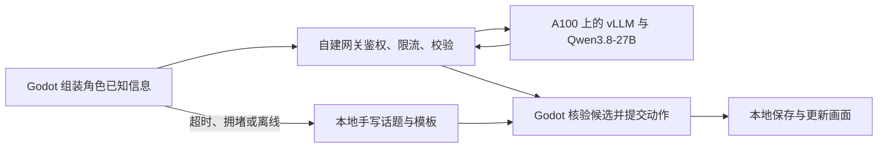

# 零点杂货铺单卡 A100 自部署方案

本月游戏的在线推理由团队自管的一张 A100 提供，模型选 **Qwen3.8-27B**，推理服务用 **vLLM**。Windows 游戏通过轻量 HTTP 网关调用，游戏规则和存档继续留在 Godot。方案以 11 月 30 日整体验收为目标，首发面向小范围试玩。以下命令和容量是待在目标服务器验证的起点。[官方模型卡](https://huggingface.co/Qwen/Qwen3.8-27B) · [全量技术分工](tech-workstreams.md)

## 先按显存选权重

在 GPU 服务器上先看显存、驱动、空闲量和是否分了 MIG。下面两条路线以游戏能独占整张卡为前提。若实际提供的是 MIG 实例或有其他常驻任务，按可用显存重新压测。建议 Linux 主机、已配置 GPU 的容器运行时和持久磁盘，权重缓存放在服务器。[A100 规格](https://www.nvidia.com/en-us/data-center/a100/) · [vLLM GPU 安装](https://docs.vllm.ai/en/latest/getting_started/installation/gpu/)

```bash
nvidia-smi -L
nvidia-smi --query-gpu=name,memory.total,memory.free,driver_version --format=csv
```

| 可用整卡 | 首选验证的模型 | 选型依据与验收重点 |
| --- | --- | --- |
| A100 80GB | `Qwen/Qwen3.8-27B` BF16 | 官方仓库约 55.6 GB。适合先验证原精度，给运行工作区和上下文缓存留空间。检查真实显存峰值、启动日志及两人并发尾延迟，再决定是否切量化。[官方权重](https://huggingface.co/Qwen/Qwen3.8-27B/tree/main) |
| A100 40GB | `RedHatAI/Qwen3.8-27B-INT4` W4A16 | 官方 BF16 权重体积超过整卡容量。此候选保留 Qwen3.8-27B 架构，压缩权重，仓库约 19.5 GB。先验启动、中文口吻和结构化输出，实际可用显存和速度以本卡测量为准。[量化模型卡](https://huggingface.co/RedHatAI/Qwen3.8-27B-INT4) · [量化权重](https://huggingface.co/RedHatAI/Qwen3.8-27B-INT4/tree/main) |

W4A16 指权重 4 位、运算激活保持 16 位。Ampere 有可用的权重量化路径，具体 checkpoint 和内核组合仍需验。首发优先测试上表两条路线。A100 的 FP8 权重可能走兼容路径，延迟与显存表现须另测。启动后锁定可用的模型 revision、vLLM 镜像 digest、驱动版本与参数，保留上一组通过配置供回退。[vLLM 量化兼容表](https://docs.vllm.ai/en/latest/features/quantization/) · [Qwen3.8 vLLM 配置参考](https://recipes.vllm.ai/Qwen/Qwen3.8-27B)

## 启动与冒烟

在服务器选择与驱动兼容、支持该 checkpoint 和所用参数的 vLLM 正式版本。用 `vllm serve --help` 核对参数。下面是 Linux 主机进程的冒烟命令，在已安装 vLLM 且设置 `MODEL_ID`、`MODEL_REVISION` 为所选仓库和具体提交后执行。Docker 部署采用同一组参数，容器监听其内部地址，主机端口只映射到回环地址或容器私网。客户端访问项目网关。[vLLM 启动参数](https://docs.vllm.ai/en/latest/cli/serve/) · [容器部署](https://docs.vllm.ai/en/latest/deployment/docker/)

```bash
vllm serve "${MODEL_ID:?select the BF16 or INT4 checkpoint}" \
  --revision "${MODEL_REVISION:?set the Hugging Face commit}" \
  --served-model-name magicstore-npc \
  --host 127.0.0.1 --port 8000 \
  --tensor-parallel-size 1 --dtype bfloat16 --kv-cache-dtype bfloat16 \
  --language-model-only --max-model-len 8192 \
  --max-num-seqs 1 --gpu-memory-utilization 0.90
```

本月在线请求只发送文字。`8192` 是总上下文上限，建议普通对话输入最多 `6144` tokens（含模板），输出最多 `256` tokens。人物草稿等低优先级任务可给 `512` tokens。常规对话每次请求设置 `chat_template_kwargs.enable_thinking = false`，网关固定参数，并用 `response_format.type = json_schema` 约束输出。若遇显存或启动问题，从一个会话、`4096` 总上下文重试，同步缩短输入预算，保留日志再调。先验基础路径，再考虑缓存、并发或推理加速。[Qwen 请求参数](https://huggingface.co/Qwen/Qwen3.8-27B#best-practices) · [vLLM 结构化输出](https://docs.vllm.ai/en/latest/features/structured_outputs/)

1. 在服务器本机确认 `/health`、`/v1/models`，用 `/v1/chat/completions` 预热。先验证一轮中文短句和一个符合 JSON Schema 的回复，再试一次接近上限的输入。
2. 通过同机网关完成林照晚的一轮真实对话、一次新顾客草稿和一次超时回退。记录模型 revision、容器 digest、是否采用量化、显存、首 token 时间、整轮延迟和无效输出原因。
3. 建议用固定的 20 条中文样例，覆盖身份记忆、澄清、长输入、越权请求和不同案件。先压单序列，稳定后再试两个同时处理的请求。建议目标为预热后 1 并发整轮 P95 ≤ 10 秒、2 并发 P95 ≤ 15 秒。客户端总超时先设 18 秒，包含排队。用 4 并发检查限流、排队和本地回退。根据实测锁定同时处理的上限。

## 游戏接入与规则边界



| 调用 | 输入与产出 | 游戏怎样使用 |
| --- | --- | --- |
| 实时对话 | 最近几轮、角色口吻、该角色已知事实、本次允许的话题及线索 ID、玩家输入。输出沿用 `reply_text`、`intent`、`clue_ids`、`needs_clarification`、`error_code` | 校验类型、长度、允许的 ID 及当前条件，合法结果才更新对话与线索。话题选项可以先用本地确定性规则，长对话按已确认事实摘要和近期轮次保留上下文 |
| 顾客与剧情草稿 | 人物模板、已建关系网、获准公开的信息和允许的分支类型。输出候选档案、反应或事件提案 | 可以预生成并低优先级排队。校验通过才为新顾客分配稳定 ID，已有身份及关系从本地档读取。B 根据事实、条件和游戏时钟裁决提案 |
| 剧情、交易与学习 | 本地保存事件、服务、库存与学习条件 | 判卜、钱货结算、解锁、反馈和奖惩由 A/B/C 各自规则计算。模型的候选文本不作为已发生事件或资源指令 |

拟用 `POST /api/npc/reply` 和 `POST /api/npc/draft` 两个白名单入口。网关拼装提示、限制请求大小和输出、校验结构化结果，再返回游戏需要的字段。Godot 沿用 `request_reply()`、异步动作入口和本地写盘。请求带 `request_id`，客户端保留对应 `action_id`、`save_id` 和 `state_version`。超时、取消、切档或读档后的迟到结果直接作废；同一动作的有效结果最多提交一次。每个存档最多一个在途对话，后台草稿让位给玩家对话。读档复用已经保存的回复和角色记录。[现有对话与存档契约](contracts.md)

试玩客户端通过团队 VPN 或带鉴权的 HTTPS 网关访问；推理端口和管理端点留在服务器内部。密钥放服务端环境或密钥存储，客户端配置地址和可撤销的试玩会话凭据。保留最小化日志，记录请求编号、耗时、错误码和 token 数。超时或过载时提供重试和本地回应；网络等待本身不改变游戏时间、资源或顾客耐心，成功采用的本地回应仍按原动作规则结算一次。[vLLM 服务安全说明](https://docs.vllm.ai/en/latest/usage/security/)

## 负责人和验收门槛

| 谁负责 | 何时交什么 |
| --- | --- |
| A 服务器、人物与对话 | **11 月 11 日**确认 40GB/80GB、驱动、模型路线并准备权重。**13 日**完成服务器冒烟、网关真实请求和 JSON 校验。**17 日**跑通一位顾客的生成和对话，保留 Mock 供其他组并行 |
| B 案例与可用意图 | 用模拟响应先做案例、术式与事件。**17 日**交允许的话题、线索和分支样例。**23 日**验证真实模型提案经过游戏规则后可追溯，不会泄露角色未知信息或直接改变事实 |
| C 客户端和整合验收 | 用假网关并行接 HTTP、地址配置、等待提示、取消、离线回退和旧档。**17 日**联通内网真实服务。**23 日**与全玩法合入，**27 日**记录并发、超时和回归数据，**30 日**在 Windows 包复验 |

终验既要用实机 A100 完成一次新顾客生成与多轮中文对话，也要断网重开已有档。覆盖缺字段、越权线索、过载、超时、切档迟到、重试和服务重启。验收材料包含两种模式的操作记录、压测数据和可重现部署配置。在线延迟超标时先缩短上下文、响应和同批任务数；保留单卡版真实联调作为 A3 完成条件。

Qwen3.8-27B 在项目里负责文字推理与结构化叙事。美术的 AI 扩图按原创样例使用独立的图像生成流程，审核成品后随游戏打包。若团队共用同一台 GPU，扩图安排在推理服务的维护窗口。[模型的输入与输出模态](https://www.alibabacloud.com/help/en/model-studio/qwen3-8-27b) · [美术制作单](art-brief.md)
